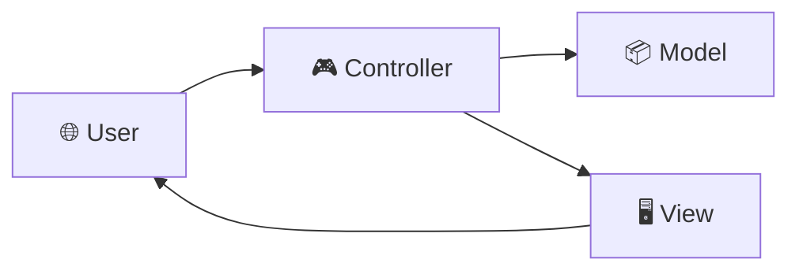

<div align="center">

# 🛒 Customer & Order Management System

### A structured ASP.NET MVC application for customer and order workflows

**A portfolio project demonstrating C# web development, MVC architecture, and separation of concerns.**

<p>
  
  
  
  
</p>

[📂 View Repository](https://github.com/MMohamedHeshamm/CustomerOrderManagmentSystem-MVC) · [👨‍💻 GitHub Profile](https://github.com/MMohamedHeshamm) · [💼 LinkedIn](https://www.linkedin.com/in/mohamedhhh/)

</div>

---

## 📌 Overview

**Customer & Order Management System** is a **C# / ASP.NET MVC** web application organized around customer and order-related business workflows.

The project demonstrates how to structure a business-focused application using the **Model–View–Controller (MVC)** pattern, keeping responsibilities separated and the codebase easier to navigate, maintain, and extend.

> 🎯 **Developer value:** Turning a business domain into an organized .NET web application while applying MVC conventions and separation of concerns.

## ✨ Project Highlights

| 🔍 Area | 💡 What it demonstrates |
| :--- | :--- |
| 👥 **Customer domain** | Organizing customer-related application concepts and workflows. |
| 📦 **Order domain** | Structuring order-related business processes within the application. |
| 🧩 **MVC pattern** | Separating data models, presentation, and request-handling logic. |
| 🛠️ **Project organization** | Working with a structured .NET solution and web application project. |
| 🚀 **Extensibility** | Providing a foundation for future features and business requirements. |

## 🧰 Tech Stack

| Technology | Purpose |
| :--- | :--- |
| **C#** | Application programming language |
| **ASP.NET MVC** | Web application framework and MVC structure |
| **.NET** | Application platform and project tooling |

> **Note:** Specific .NET versions, database providers, ORM packages, and external libraries should be added only after checking the source project configuration.

## 🏗️ Architecture

The project is organized around the **MVC architectural pattern**:



- **Model 📦** — Represents application data and domain concepts.
- **View 🖥️** — Renders the user-facing interface.
- **Controller 🎮** — Receives requests and coordinates application flow.

This separation makes the application structure easier to understand and supports maintainable development.

## 📁 Repository Structure

```text
CustomerOrderManagmentSystem-MVC/
├── CustomerOrderManagmentSystem/            # Application source
├── CustomerOrderManagementSystem-MVC.slnx    # .NET solution
├── .gitignore
└── .gitattributes
```

## ⚙️ Getting Started

### ✅ Prerequisites

- A compatible **.NET SDK** for the target framework
- **Visual Studio** with ASP.NET/web development support (or another compatible IDE)
- Any local configuration required by the application

### 🚀 Run Locally

**1. Clone the repository**

```bash
git clone https://github.com/MMohamedHeshamm/CustomerOrderManagmentSystem-MVC.git
```

**2. Open the solution**

Open `CustomerOrderManagementSystem-MVC.slnx` in a compatible version of Visual Studio.

**3. Restore and configure**

Restore NuGet packages and review the application's local settings, including any connection strings if the project uses a database.

**4. Run the application**

Set the web application as the startup project, then run it from your IDE.

## 🎯 What This Project Demonstrates

- 💻 **C# and ASP.NET development:** Building within the .NET web ecosystem.
- 🧱 **Separation of concerns:** Keeping the application organized through MVC.
- 📐 **Business-oriented thinking:** Structuring the code around customer and order concepts.
- 🔧 **Maintainability:** Creating an understandable foundation for further development.

## 🗺️ Future Improvements

Potential areas for future enhancement (not claimed as current features):

- [ ] 🔐 Authentication and role-based authorization
- [ ] ✅ Automated unit and integration tests
- [ ] 🔎 Search, filtering, and pagination
- [ ] 🛡️ Stronger validation and centralized error handling
- [ ] 📈 Structured logging and deployment documentation

## 👨‍💻 Author

**Mohamed H. Eldesouky**  
*Backend Engineer | .NET Developer*

[](https://github.com/MMohamedHeshamm)
[](https://www.linkedin.com/in/mohamedhhh/)

---

<div align="center">

⭐ **If you find this project useful, consider starring the repository!**

</div>
